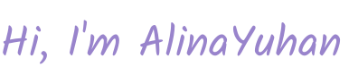
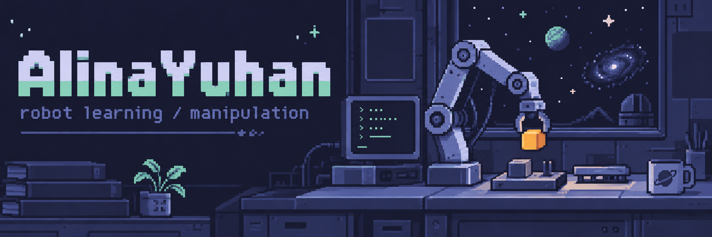

**Embodied AI · Robot Learning**

I work on **robot learning for manipulation**, with hands-on experience in **VLA adaptation, 3D perception, and real-robot deployment**.

🧠 Exploring **agentic robotics** and **lightweight VLA models**.

🔭 Interested in **reinforcement & continual learning for self-improving robotic agents**, **generalist robot policies & generalization**, **world action models (WAM)**, **spatial intelligence & physical AI**, and **tactile/force sensing for dexterous manipulation**.

### Tools & platforms

                 

<strong>Robot platforms:</strong>   

### Open-source corner

- [**G1 Voice Interaction**](https://github.com/AlinaYuhan/g1-voice-interaction-pipeline) · Voice interaction and action execution on Unitree G1
- [**3D Keypoints**](https://github.com/AlinaYuhan/keypoints) · Learning structure from 3D geometry
- [**BetaUp**](https://github.com/AlinaYuhan/betaup) · A side project for climbers

